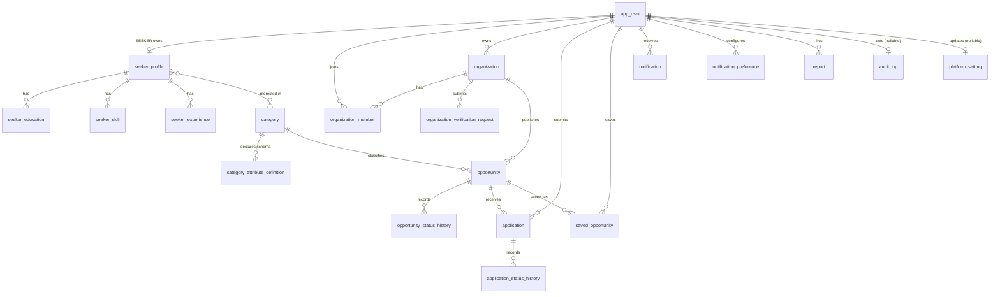

# TDOP Data Model (Phase 2)

**Status:** Phase 2 — Database architecture. Created 2026-11-07 on `feature/phase2-database-architecture`, pending review.
**Authority:** implements [D-003](DECISIONS.md) (PostgreSQL + Flyway, no Hibernate auto-DDL) and [D-004](DECISIONS.md) (UUID identifiers, normalized entities, UTC timestamps, foreign keys, uniqueness constraints, targeted indexes, bounded versioned JSONB for category-specific fields).

This document is the ER design. The migrations in `backend/src/main/resources/db/migration/` implement it exactly; the two must not drift, and any schema change lands as a new migration.

---

## 1. Conventions

| Rule | Value |
| --- | --- |
| Identifier | `uuid` primary key, default `gen_random_uuid()` (built into PostgreSQL 13+) |
| Naming | `snake_case`; plural table names; foreign keys named `<referenced>_id` |
| Timestamps | `timestamptz` (UTC instants); `created_at` defaults to `now()` |
| Deletable children | `ON DELETE CASCADE` for owned child rows (profile parts, members, history) |
| Protected parents | `ON DELETE RESTRICT` where silent data loss would be wrong (opportunities, category usage) |
| Bounded vocabularies | `varchar` + `CHECK (... IN (...))`, not native `ENUM` types — additive `CHECK` changes are cheap, `ALTER TYPE ... ADD VALUE` cannot run inside a transaction block |
| JSON columns | `jsonb`, always with `CHECK (jsonb_typeof(col) = 'object')` so `null`/scalar documents can never be stored |
| Case-insensitive email | functional unique index on `(lower(email))`, not a duplicated normalized column |

Audited tables carry `updated_at`, maintained by the application layer. The database does **not** auto-touch `updated_at` (no triggers): Flyway owns the schema, and application-owned values stay application-owned. This is deliberate and is a known gap until the persistence layer lands in Phase 3+.

---

## 2. Entity-relationship overview



Ownership and access rules are described in [REQUIREMENTS.md](REQUIREMENTS.md); the schema enforces **structure**, and service-layer authorization is enforced from Phase 4 onward.

---

## 3. Entities

### 3.1 Identity

- **`app_user`** — the single account record for every actor (`system_role`: `SEEKER` | `ORGANIZATION_ADMIN` | `ADMIN`; `status`: `PENDING` | `ACTIVE` | `SUSPENDED` | `DELETED`; `locale`: `en` | `sw`). Unique on `lower(email)` because email login must be case-insensitive.
- **`seeker_profile`** — 1:1 with an `app_user` that is a seeker. Name, phone, headline, bio, region/district, `profile_visibility` (`PRIVATE` | `PUBLIC`). No image column: profile pictures are private object storage under [D-008](DECISIONS.md).
- **`seeker_education`**, **`seeker_skill`**, **`seeker_experience`** — owned, ordered child rows that back internal applications ([D-007](DECISIONS.md)). Date ranges are guarded by `CHECK (end_date >= start_date)`; skills are unique per profile case-insensitively.
- **`seeker_interest`** — seeker-to-category preferences; `UNIQUE (profile_id, category_id)`.

### 3.2 Reference data

- **`category`** — the data-driven catalogue. `code`, `slug`, `name_en`, `name_sw`, `display_order`, `is_active`. Adding a category is an insert, never a redesign (see §5).
- **`category_attribute_definition`** — the **versioned, server-owned** schema for category-specific fields. One row per attribute per `(category, schema_version)`:

  | Column | Purpose |
  | --- | --- |
  | `attribute_key` | snake_case key stored inside `opportunity.attributes` |
  | `label_en`, `label_sw` | bilingual UI labels |
  | `data_type` | `TEXT` \| `INTEGER` \| `DECIMAL` \| `DATE` \| `BOOLEAN` \| `ENUM` |
  | `is_required` | server-side requiredness |
  | `allowed_values` | JSON array of permitted values, required for `ENUM` |
  | `min_value`, `max_value`, `min_length`, `max_length` | numeric/text bounds |
  | `display_order` | presentation order |

  These rows are written by administrators/migrations only — never accepted from a public client ([D-004](DECISIONS.md): "never trust client-provided schemas").

### 3.3 Organization

- **`organization`** — `owner_user_id`, `slug` (unique), contact fields, region/district, and `verification_status` (`UNVERIFIED` | `SUBMITTED` | `PENDING` | `VERIFIED` | `REJECTED` | `SUSPENDED`). The vocabulary matches [REQUIREMENTS.md](REQUIREMENTS.md) §"Organization trust and moderation" and is explicitly **provisional** until Phase 6 confirms it.
- **`organization_member`** — membership with `member_role` (`OWNER` | `MANAGER` | `MEMBER`) and `status` (`INVITED` | `ACTIVE` | `REMOVED`); `UNIQUE (organization_id, user_id)`.
- **`organization_verification_request`** — the traceable verification workflow. `CHECK` ties outcome to timestamp: a decided status requires `decided_at`, and an undecided status forbids it. `document_key` stores only the object-storage key (D-008).

### 3.4 Opportunity

- **`opportunity`** — common fields as typed columns (D-004: "keep opportunity fields common to all categories as typed columns"): `title`, `summary`, `description`, `region`, `district`, `work_mode`, `opportunity_type`, `application_mode`, `external_url`, provenance (`source_name`, `source_url`), `moderation_status`, `publication_status`, `opens_at`, `closes_at`, `published_at`, `created_by_user_id`, and the JSONB extension `attributes` with `attributes_schema_version`.
- **`opportunity_status_history`** — append-only record of moderation and publication transitions (`status_kind` distinguishes the two axes so approval cannot silently move publication state).

Structural guarantees enforced by `CHECK` on `opportunity`:

| Constraint | Rule |
| --- | --- |
| `ck_opportunity_dates` | `closes_at` is null or strictly after `opens_at` |
| `ck_opportunity_external_url` | `application_mode = 'EXTERNAL'` requires `external_url` |
| `ck_opportunity_published_approved` | `publication_status = 'PUBLISHED'` requires `moderation_status = 'APPROVED'` |
| `ck_opportunity_published_at` | `publication_status = 'PUBLISHED'` requires `published_at` |
| `ck_opportunity_attributes_object` | `attributes` is a JSON **object** |

### 3.5 Application and engagement

- **`application`** — internal applications only. `UNIQUE (opportunity_id, seeker_user_id)` implements the duplicate prevention of [D-007](DECISIONS.md). `status`: `SUBMITTED` | `UNDER_REVIEW` | `SHORTLISTED` | `ACCEPTED` | `REJECTED` | `WITHDRAWN`. `form_responses` is `jsonb` guarded to be an object.
- **`application_status_history`** — append-only transitions with optional `reason`.
- **`saved_opportunity`** — `UNIQUE (user_id, opportunity_id)`; ownership is by user id so one seeker can never read another's list.
- **`notification`** / **`notification_preference`** — in-app notifications only for the MVP (no SMS/WhatsApp/push); `read_at` null means unread; preferences are unique per `(user, type)`.

### 3.6 Governance

- **`report`** — user reports of suspicious content. `target_type`/`target_id` is deliberately polymorphic, so **no foreign key exists on `target_id`**; referential drift is accepted and handled by service-layer checks. Documented as an accepted trade-off.
- **`audit_log`** — append-only trail (`actor_user_id` nullable for system actions) with `jsonb` details and optional source `inet` address.
- **`platform_setting`** — key/value configuration; `setting_key` is the natural primary key, `value` is `jsonb`.

---

## 4. Query and index analysis (required by D-004 before migrations)

D-004 requires verifying query/index implications **before** creating migrations. The MVP filter list in [REQUIREMENTS.md](REQUIREMENTS.md) is *keyword, category, location, opportunity-type, deadline and organization* — plus sort/pagination.

| Query pattern | Access path created in the baseline |
| --- | --- |
| Login by email (any case) | unique index `ux_app_user_lower_email` on `(lower(email))` |
| Public listing: published + deadline ordering | `ix_opportunity_publication_published` on `(publication_status, published_at DESC)`; `ix_opportunity_publication_closing` on `(publication_status, closes_at)` |
| Filter by category | `ix_opportunity_category` on `(category_id)` |
| Filter by organisation / org dashboard | `ix_opportunity_organization` on `(organization_id)` |
| Filter by location | `ix_opportunity_region_district` on `(region, district)` |
| Filter by opportunity type | `ix_opportunity_type` on `(opportunity_type)` where not null |
| Keyword search (MVP) | **deferred to Phase 8** — no `tsvector` column is created now; a Phase 8 migration adds full-text search after measurements (D-004: "add indexes from measured query plans") |
| Seeker's applications | `ux_application_opportunity_seek` unique on `(opportunity_id, seeker_user_id)` + `ix_application_seek_status` on `(seeker_user_id, status)` |
| Org reviewing applications | `ix_application_opportunity_status` on `(opportunity_id, status)` |
| Unread notifications | partial index `ix_notification_unread` on `(user_id, created_at DESC)` `WHERE read_at IS NULL` |
| History reads | `ix_opportunity_status_history` on `(opportunity_id, created_at)`; `ix_application_status_history` on `(application_id, created_at)` |
| Audit lookup | `ix_audit_log_entity` on `(entity_type, entity_id, created_at DESC)` |

**Why there is no GIN index on `attributes`:** every MVP filter maps to a typed column. Category-specific attributes (`salary_min`, `funding_type`, `prize_pool`, …) are *not* in the MVP filter set, so a GIN/expression index would be paid for on every write and never used. Phase 8 adds a targeted expression index only if a measured plan shows a real filter on a specific `attributes` key.

---

## 5. Category / JSONB model validation

D-004 and [SYSTEM_ARCHITECTURE.md](SYSTEM_ARCHITECTURE.md) require validating the "normalized category table + versioned JSONB extension" model against **concrete** category requirements before writing migrations. The initial 12 categories from [PROJECT_OVERVIEW.md](PROJECT_OVERVIEW.md) were walked through; representative category-specific fields:

| Category | Category-specific attributes | Type |
| --- | --- | --- |
| Jobs | `salary_min`, `salary_max`, `salary_currency`, `experience_level`, `education_level` | `DECIMAL`, `DECIMAL`, `ENUM`, `ENUM`, `ENUM` |
| Internships and Industrial Training | `duration_weeks`, `stipend_amount`, `supervisor_title` | `INTEGER`, `DECIMAL`, `TEXT` |
| Scholarships and Educational Funding | `funding_type`, `coverage_amount`, `eligible_study_levels`, `sponsor_name` | `ENUM`, `DECIMAL`, `ENUM[]`→`ENUM`, `TEXT` |
| Fellowships | `duration_months`, `stipend_amount`, `host_organisation` | `INTEGER`, `DECIMAL`, `TEXT` |
| Grants and Funding | `grant_size_min`, `grant_size_max`, `funding_stage` | `DECIMAL`, `DECIMAL`, `ENUM` |
| Professional Training | `certificate_awarded`, `delivery_mode`, `training_hours` | `BOOLEAN`, `ENUM`, `INTEGER` |
| Entrepreneurship and Business Incubation | `incubation_months`, `equity_required`, `cohort_size` | `INTEGER`, `BOOLEAN`, `INTEGER` |
| Innovation Challenges | `challenge_theme`, `solution_scope`, `ip_terms` | `TEXT`, `ENUM`, `TEXT` |
| Hackathons and Competitions | `team_size_min`, `team_size_max`, `prize_pool`, `theme` | `INTEGER`, `INTEGER`, `DECIMAL`, `TEXT` |
| Volunteering | `commitment_hours_weekly`, `duration_weeks`, `living_stipend` | `INTEGER`, `INTEGER`, `DECIMAL` |
| Research | `research_field`, `funding_type`, `ethics_review_required` | `TEXT`, `ENUM`, `BOOLEAN` |
| Conferences and Events | `event_starts_on`, `event_ends_on`, `venue`, `attendance_mode`, `registration_fee` | `DATE`, `DATE`, `TEXT`, `ENUM`, `DECIMAL` |

**Findings**

1. **Every** category-specific field observed is a scalar (`TEXT`, `INTEGER`, `DECIMAL`, `DATE`, `BOOLEAN`) or a bounded enum — none needs nested/relational structure inside JSONB. The extension stays bounded, exactly as D-004 requires.
2. Fields shared by *all* categories (title, description, category, organisation, location, application mode, provenance, verification, publication state, opening/closing dates) are already typed columns on `opportunity`; nothing in the table above is duplicated there.
3. Apparent overlaps (`duration_weeks`, `coverage_amount`) have **different semantics** per category (a scholarship's coverage is not a volunteering commitment), so promoting them to shared columns would create nullable, ambiguous columns. They remain per-category keys.
4. **Filtering implication:** none of these fields appears in the MVP filter list (§4), so the model needs no JSONB index at write time — confirmed as a deliberate, low-cost position that Phase 8 can revisit with measured plans.
5. **Versioning implication:** an opportunity pins `attributes_schema_version`. When a category's definitions change, existing rows keep their pinned version and continue to validate against it; a backfill migration moves them forward deliberately, never implicitly. Definition rows are therefore immutable per version in practice — changes create `schema_version + 1`.
6. **Validation implication:** values are checked against `category_attribute_definition` rows **server-side** in Phase 7. Until that service exists, only the structural `CHECK (jsonb_typeof(attributes) = 'object')` is enforced — see §7.

**Conclusion:** the model validates. `category` + `category_attribute_definition` carries the schema; `opportunity.attributes` carries only bounded, versioned, typed values; no category requires a table redesign or a schema migration of its own.

---

## 6. Migrations, seed profile and rollback/forward

### 6.1 Layout

```
backend/src/main/resources/db/
├── migration/   # applied always by Flyway — the production schema
│   ├── V1__identity_categories_and_organizations.sql
│   ├── V2__opportunities.sql
│   ├── V3__applications_and_engagement.sql
│   └── V4__governance.sql
└── seed/        # NOT a Flyway migration — see 6.2
    └── dev_seed.sql
```

Flyway owns the schema ([D-003](DECISIONS.md)); Hibernate/`ddl-auto` is not used. Schema migrations are numbered `V1`, `V2`, … and nothing else is on the Flyway location list.

### 6.2 Seed isolation ([D-014](DECISIONS.md): development seed data is separate from production)

The seed is **not** a Flyway migration. If it were (`V1000__…`), a seeded database would carry a history entry that an unseeded one lacks, and opening that unseeded database with default locations would fail validation with `APPLIED_MIGRATION_NOT_RESOLVED` — the schema history would silently diverge between environments.

Instead, `db/seed/dev_seed.sql` is executed by `tz.tdop.seed.DevSeedRunner`, an `ApplicationRunner` that is a Spring bean only when the `seed` profile is active:

- **Normal or production start:** the bean does not exist; only `db/migration` runs and no seed row is ever written.
- **`seed` profile start** (`make backend-run-seed`, `scripts\dev.ps1 -Task backend-run-seed`, or `SPRING_PROFILES_ACTIVE=seed`): the runner calls `flyway.migrate()` first (a no-op when current), then executes the seed script in a single transaction that rolls back on any error.
- **Idempotent:** every insert uses a fixed UUID (`00000000-0000-4000-8000-…`) and `on conflict do nothing`, so re-running is safe and the schema history stays byte-identical whether or not the profile is active.

The seed contains the 12 reference categories, sample attribute definitions, and clearly-marked development actors with a **non-functional placeholder password hash** (`PLACEHOLDER-HASH-NO-LOGIN-POSSIBLE`) — it is not a credential and cannot log anyone in. A `platform_setting` row (`seed_data_marker`) makes a seeded database identifiable.

### 6.3 Rollback / forward policy

Flyway's undo migrations are a paid edition feature, so this project is **forward-only**, by explicit policy:

| Situation | Procedure | Status |
| --- | --- | --- |
| Forward, empty database | `flyway migrate` applies `V1 → V4` in order; re-running is a no-op (`validate` stays clean) | **Verified by test** (`FlywayMigrationTest`) |
| Forward, replay | drop schema → migrate again → schema fingerprint (tables, columns, types, nullability, constraints, indexes) is byte-identical | **Verified by test** |
| Rollback of a bad migration | restore the pre-deploy database snapshot, revert the offending migration file **or** add a compensating `V<n+1>` migration, then migrate forward | **Documented only** — no automated test (it needs a snapshot/backup mechanism that does not exist yet; production backup design is Phase 17) |
| Repair of a failed partial migration | `flyway repair` clears the failed history entry after the cause is fixed | **Documented only**; requires manual access to the target database |

Nothing in this repository claims an automated database rollback. That gap is real and is recorded in §7.

---

## 7. Explicitly out of scope / not yet enforced

Stated plainly so nothing here is mistaken for working behaviour:

1. **No JPA/Hibernate entities or repositories in Phase 2.** Persistence tests use `JdbcTemplate` against the real schema. Entity mapping arrives with the features that need it (Phases 5–9), while D-003 continues to forbid `ddl-auto` for schema creation.
2. **No HTTP API.** Phase 2 exposes no endpoint; [D-005](DECISIONS.md) (`/api/v1` DTOs) begins in Phase 3.
3. **Attribute value validation is not implemented.** The database checks that `attributes` is an object; comparing values against `category_attribute_definition` happens in Phase 7. Nothing claims otherwise today.
4. **"Organisation must be verified before publishing" is not enforced yet.** `ck_opportunity_published_approved` guarantees *moderation* approval precedes publication, but the organisation-verification gate is a cross-row rule that requires the Phase 6/7 service layer (or a trigger). It is an open item, not a working control.
5. **`application` ↔ `application_mode = 'INTERNAL'` is not enforced.** A trigger could reject applications against external opportunities; deferred to Phase 9 with the rest of the application workflow.
6. **No full-text search column or GIN index** (§4).
7. **No object-storage bytes in the database** (D-008) — only `document_key` metadata.
8. **`report.target_id` has no foreign key** (§3.6) — accepted polymorphic trade-off.

---

## 8. How to verify this phase

```bash
# migrations apply from an empty database, and re-apply identically
cd backend && ./mvnw -B verify          # requires a reachable PostgreSQL (see docs/DEVELOPMENT_GUIDE.md)
```

Actual command results are recorded in the [Phase 2 verification record](DEVELOPMENT_GUIDE.md#phase-2-verification-record-2026-11-07): 23 tests, 0 failures, 0 errors, formatter validation clean.
