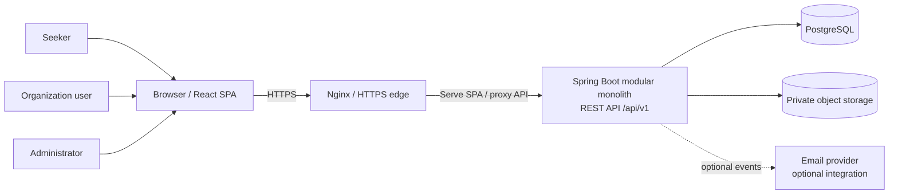

# TDOP System Architecture

**Status:** Proposed architecture baseline, recorded in Phase 0. This is a design, not an implemented system. Phase 1 initializes the monorepo only after owner approval; later phase gates validate details against actual code and dependencies.

## Architectural style

Start with a **modular monolith** backend and a separate React single-page application in one repository. A single deployable Spring Boot service is easier to secure, test and operate for the initial team than premature microservices. Keep domain boundaries clear so a future extraction is possible only if measured scale or organizational ownership justifies it.

The backend uses layered responsibilities—controllers, application services, repositories, domain entities, DTOs/mappers, validation, security, configuration and exceptions—organized by feature. Public APIs use `/api/v1`, REST conventions, validation, pagination and stable DTO contracts. JPA entities are never public API responses.

## Context and runtime boundary



Nginx is the planned production TLS/reverse-proxy boundary. The exact hosting provider and whether the SPA and API share an origin remain deployment decisions for Phase 17. Prefer same-origin API routing where practical; otherwise use an explicit production CORS allowlist and test cookie/CSRF behavior.

## Backend modules

Planned feature boundaries:

- `identity-access`: accounts, roles, sessions, authorization and account status.
- `seeker-profile`: profile, education, skills, experience, interests and preferences.
- `organizations`: membership, profile and verification workflow.
- `opportunities`: categories, sources, publishing, search criteria and lifecycle.
- `applications`: internal submissions, status transitions and history; external destination metadata remains separate.
- `saved-opportunities`: seeker-owned saves and comparison inputs.
- `notifications`: in-app event notifications and preferences; delivery adapters can be added later.
- `moderation`: reports, review decisions and publication controls.
- `administration-audit`: protected administration actions, metrics queries and audit records.

Modules may share domain types through explicit interfaces within the monolith; do not create separate services or databases without an approved decision.

## Data and persistence strategy

- PostgreSQL is the system of record; Flyway owns schema evolution. Hibernate/JPA maps persistence objects but does not auto-create production schema.
- Use UUID primary keys where appropriate, foreign keys, unique constraints and explicit deletion rules. Store event times as UTC `timestamptz`; format dates for users using the selected locale/timezone.
- Normalize core records: users/roles, seeker profiles and profile collections, organizations/memberships/verifications, categories, opportunities/sources, applications/status history, saved opportunities, notifications/preferences, reports and audit logs.
- Keep shared opportunity fields relational and index frequently filtered fields (publication status, category, organization, location and closing date). Add indexes from measured query plans; avoid indexing every field.
- Make categories data-driven. A planned approach is a normalized category table plus a typed, versioned and server-validated JSONB extension for genuinely category-specific attributes. Keep core fields out of JSONB and never trust client-provided schemas. Phase 2 must validate this model against concrete category requirements before migrations are written.
- Enforce unique normalized account email, unique seeker/opportunity application and unique seeker/opportunity saved-item constraints. Use explicit status-history rows for auditable transitions.
- Archive opportunities and preserve necessary application/audit history. Account deletion/anonymization and retention policies require a privacy/legal review before production; cascading deletes must not erase audit or application history accidentally.
- Use page-based API pagination initially; assess full-text/trigram indexing and query performance with representative data before adding search infrastructure.

No entities, migrations, seed records or database services exist yet.

## Authentication and authorization design

- Spring Security is the backend enforcement point. Build authorization from server-verified roles, resource ownership and organization membership; frontend route guards are only UX.
- Use an adaptive password hash (initial candidate: BCrypt, strength configurable by deployment and measured on target hardware).
- Use short-lived signed JWT access tokens. Keep access tokens in memory in the browser, not local storage. Use high-entropy opaque refresh tokens in a Secure, HttpOnly, SameSite cookie; store only a hash server-side, rotate on refresh, detect reuse and support revocation/logout. Apply CSRF protections to cookie-authenticated refresh/logout operations.
- Keep role data extensible for a future super-administrator, but do not grant elevated permissions by default. Sensitive admin actions require audit records.
- Apply authentication rate limits, generic credential errors, secure headers and a strict CORS allowlist. Never log tokens, passwords, verification documents or unnecessary personal data.

Cookie domain/SameSite settings depend on the final production origin arrangement and must be security-tested before release.

## File and external-service strategy

Profile photos and organization verification documents are private or access-controlled media, not database blobs. Introduce a storage adapter for an S3-compatible object store; development may use an isolated compatible service after Phase 1. Enforce size/type allowlists, content inspection, safe generated names, malware scanning where available, authorization and short-lived access links. The provider, data region, retention, backups and operational cost remain open for Phase 17. Internal application file attachments are out of the initial release scope.

Email and other outbound delivery use an adapter and environment-managed provider configuration. SMS, WhatsApp and push are deferred. Do not build or claim a delivery channel before it is configured and tested.

## Localization and presentation

The frontend is a React/TypeScript SPA with reusable feature and design-system components. Use i18next for English/Swahili interface strings, semantic HTML and responsive mobile-first layouts. User preference selects locale; store event timestamps in UTC and format with an explicit locale and `Africa/Dar_es_Salaam` default for Tanzania. A design token baseline is in [Project Overview](PROJECT_OVERVIEW.md). Content supplied by organizations is not automatically translated.

## Observability and deployment

Use structured, redacted application logs, health checks and Spring Boot Actuator with only safe endpoints exposed. Platform metrics must be database-backed; operational telemetry and user analytics are separate. Docker Compose will support local development. Production uses HTTPS, managed secrets, restricted database/network access, backups, restore drills and monitored health checks. Cloud vendor, object-store vendor, email service and deployment topology are deliberately deferred until operational requirements and cost are reviewed.

## Planned repository boundaries

```text
backend/          Spring Boot modules, tests, Flyway migrations
frontend/         React app, features, shared UI, localization
infrastructure/   Nginx and deployment assets
scripts/          Cross-platform development/validation helpers
docs/             Product, design, architecture and operations docs
.github/          CI workflows, issue forms and PR template
```

Only root policy files and Phase 0 documentation are being created now. The directory plan is not a claim that these folders exist.

## Open decisions for later phases

- Exact production hosting, domain, TLS, network topology and data regions.
- Object storage vendor, malware-scanning approach, retention and upload limits.
- Verified private security contact and incident response process.
- Privacy/legal review for Tanzania and any additional launch jurisdictions.
- Email provider, browser support baseline, performance targets and service-level objectives.
- Detailed dynamic opportunity field schema and application questionnaire rules.
